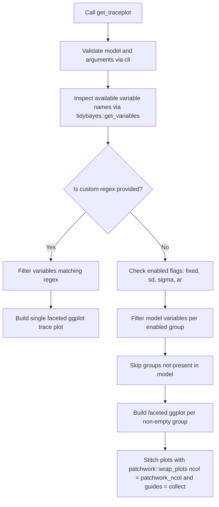

# Plan: `get_traceplot()` Function

## Overview
Create [`get_traceplot()`](R/get_traceplot.R) to generate publication-ready MCMC trace plots for Bayesian models (such as `brmsfit` objects) using `{tidybayes}`, `{ggplot2}`, and `{patchwork}`.

By default, it targets the key structural parameters of interest—fixed effects (`b_*`), group-level standard deviations (`sd_*`), residual standard deviations (`sigma*`), and autoregressive parameters (`ar*` / `cor_ar*`)—while deliberately omitting individual random effect trajectories (`r_*`) to keep diagnostic plots clean and readable.

When multiple parameter groups are active and present in the model, each group is plotted in its own faceted `ggplot2` section and combined vertically (or via a user-configurable layout) using `patchwork::wrap_plots(..., guides = "collect")`.

---

## Proposed Function Signature

```r
get_traceplot <- function(
  model,
  fixed = TRUE,
  sd = TRUE,
  sigma = TRUE,
  ar = TRUE,
  regex = NULL,
  alpha = 1,
  linewidth = 0.5,
  scales = "free_y",
  facet_ncol = NULL,
  patchwork_ncol = 1
)
```

### Arguments
- `model`: A fitted Bayesian model object supported by `{insight}` and `{tidybayes}` (typically a `brmsfit` object).
- `fixed`: Logical (`TRUE` / `FALSE`). Include population-level (fixed) effects matching `^b_`. Default is `TRUE`.
- `sd`: Logical (`TRUE` / `FALSE`). Include group-level (random-effects) standard deviations matching `^sd_`. Default is `TRUE`.
- `sigma`: Logical (`TRUE` / `FALSE`). Include residual/distributional scale parameters matching `^sigma`. Default is `TRUE`.
- `ar`: Logical (`TRUE` / `FALSE`). Include autoregressive parameters matching `^(ar(\\[|$)|cor_ar)`. Default is `TRUE`.
- `regex`: Optional character string (`NULL` by default). When supplied, overrides the boolean flags (`fixed`, `sd`, `sigma`, `ar`) and extracts all parameters matching this custom regular expression into a single faceted trace plot.
- `alpha`: Single numeric value in `[0, 1]` controlling line opacity. Default is `1`.
- `linewidth`: Single positive numeric value controlling trace line width. Default is `0.5`.
- `scales`: Character string passed to `ggplot2::facet_wrap(scales = ...)`. Must be one of `"free_y"` (default), `"fixed"`, `"free_x"`, or `"free"`.
- `facet_ncol`: Optional positive integer (`NULL` by default) passed to `ggplot2::facet_wrap(ncol = ...)` to control the number of columns within each parameter section.
- `patchwork_ncol`: Optional positive integer (`1` by default) passed to `patchwork::wrap_plots(ncol = ...)` to stack parameter sections vertically by default while allowing side-by-side arrangements if desired.

---

## Architecture & Workflow



### Detailed Behavior
1. **Available Variable Discovery**:
   - Query variable names in `model` via `tidybayes::get_variables(model)`.
   - If `regex` is `NULL`:
     - Map enabled flags (`fixed`, `sd`, `sigma`, `ar`) to their respective patterns:
       - `fixed`: `"^b_"`
       - `sd`: `"^sd_"`
       - `sigma`: `"^sigma"`
       - `ar`: `"^(ar(\\[|$)|cor_ar)"`
     - If a model does not have any parameters for an enabled flag (e.g., a non-hierarchical model has no `^sd_`, or a cross-sectional model has no `ar`), silently skip that section rather than throwing an error.
     - If **no** variables match across any enabled flags (or if all flags are `FALSE` and `regex = NULL`), abort with an informative `cli::cli_abort()` error.
   - If `regex` is non-`NULL`:
     - Match `regex` against `tidybayes::get_variables(model)`.
     - If no variables match `regex`, abort with a `cli::cli_abort()` error (`peoplenotp_error_no_matching_variables`).

2. **Extracting Draws & Plotting Each Section**:
   - Use `tidybayes::gather_draws(model, !!rlang::sym(pattern), regex = TRUE)` for each matched group.
   - Build each section plot as:
     ```r
     ggplot2::ggplot(draws, ggplot2::aes(x = .iteration, y = .value)) +
       ggplot2::geom_line(
         ggplot2::aes(color = factor(.chain), group = .chain),
         alpha = alpha,
         linewidth = linewidth
       ) +
       ggplot2::facet_wrap(~.variable, scales = scales, ncol = facet_ncol) +
       ggplot2::labs(color = "Chain")
     ```
   - Combine the section plots using:
     ```r
     patchwork::wrap_plots(plot_list, ncol = patchwork_ncol, guides = "collect")
     ```

3. **Package Dependencies & Globals**:
   - Add `patchwork` to `Imports` in [`DESCRIPTION`](DESCRIPTION:22).
   - Register `.chain`, `.iteration`, `.value`, and `.variable` in [`R/globals.R`](R/globals.R:1).
   - Export `get_traceplot` via roxygen2 `@export` tag.
   - Write comprehensive unit tests in `tests/testthat/test-get_traceplot.R` using `local_mocked_bindings` (matching [`tests/testthat/test-get_posteriorpc.R`](tests/testthat/test-get_posteriorpc.R:1)).
