# Output Column Reduction Plan for Clinical Certainty Functions

## Summary of Changes

Reduce the default output columns of [`get_clinical_certainty()`](R/get_clinical_certainty.R:94) and [`get_joint_clinical_certainty()`](R/get_joint_clinical_certainty.R:121) to their essential numerical metrics, moving ROPE bounds, clinical status, and marginal statistics behind optional toggle arguments.

---

## 1. `get_clinical_certainty()`

### Current vs New Defaults

- **Current Columns (10 cols by default)**:
  `median`, `lower`, `upper`, `pd`, `rope_low`, `rope_high`, `rope_pct`, `improvement_pct`, `deterioration_pct`, `clinical_status`
- **New Default Columns (6 cols)**:
  `median`, `lower`, `upper`, `pd`, `improvement_pct`, `deterioration_pct`

### Arguments

- `include_status`: logical scalar, defaults to `FALSE`. When `TRUE`, appends `clinical_status`.
- `include_rope`: logical scalar, changed default from `TRUE` to `FALSE`. When `TRUE`, appends `rope_low`, `rope_high`, `rope_pct`.

---

## 2. `get_joint_clinical_certainty()`

### Current vs New Defaults

- **Current Columns (12 cols by default)**:
  `median_1`, `lower_1`, `upper_1`, `pd_1`, `median_2`, `lower_2`, `upper_2`, `pd_2`, `joint_pd`, `joint_improvement_pct`, `joint_deterioration_pct`, `joint_clinical_status`
- **New Default Columns (9 cols)**:
  `median_1`, `lower_1`, `upper_1`, `median_2`, `lower_2`, `upper_2`, `joint_pd`, `joint_improvement_pct`, `joint_deterioration_pct`

### Arguments

- `include_status`: logical scalar, defaults to `FALSE`. When `TRUE`, appends `joint_clinical_status` (and `clinical_status_1`, `clinical_status_2` if `include_marginals = TRUE`).
- `include_marginals`: logical scalar, defaults to `FALSE`. When `TRUE`, appends marginal metrics:
  - `pd_1`, `improvement_pct_1`, `deterioration_pct_1`
  - `pd_2`, `improvement_pct_2`, `deterioration_pct_2`
  (and `clinical_status_1`, `clinical_status_2` if `include_status = TRUE`).

---

## 3. Architecture Diagram

```mermaid
flowchart TD
    subgraph SingleOutcome [Single Outcome Workflow]
        A[Posterior Draws] --> B[compute_certainty_draws]
        B --> C[Core Metrics: median, lower, upper, pd, improvement_pct, deterioration_pct]
        C --> D{include_rope?}
        D -- Yes --> E[Append rope_low, rope_high, rope_pct]
        D -- No --> F[Skip ROPE bounds]
        E --> G{include_status?}
        F --> G
        G -- Yes --> H[Append clinical_status]
        G -- No --> I[Return tibble]
        H --> I
    end

    subgraph JointOutcome [Joint Outcome Workflow]
        J[Two Posterior Draws] --> K[compute_joint_certainty_draws]
        K --> L[Core Metrics: median_1, lower_1, upper_1, median_2, lower_2, upper_2, joint_pd, joint_imp_pct, joint_det_pct]
        L --> M{include_marginals?}
        M -- Yes --> N[Append pd_1, imp_1, det_1, pd_2, imp_2, det_2]
        M -- No --> O[Skip Marginals]
        N --> P{include_status?}
        O --> P
        P -- Yes --> Q[Append joint_clinical_status and marginal statuses if requested]
        P -- No --> R[Return tibble]
        Q --> R
    end
```

